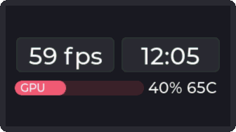

# Meter bars and sensor readings

There are many customization options for displaying different data types. This is a general reference for the
configuration options given to either the CLI or the HTTP interfaces.

## Sensor data

Sensor readings are passed to `setsensor` in groups of at most 3 values:
- `value1` (mandatory): determines the amount to fill a meter bar;
- `value2`: can potentially be used in the side label to show additional data;
- `valueP`: can be used to show additional data on the inside the notification tray (notifications will be hidden).

Additionally, either of the readings can be used to:
- determine the color of the meter bar,
- show the meter bar only when the value is greater than the chosen threshold.

All the 3 values are always positive integers (precisely `uint32_t`).

## Meter bar configuration

Configuration is stored in flash memory and persists over reboots. You can change it any time by using the
`sensorconfig` CLI command or HTTP request. 

### Index
  - CLI argument: `<index>` (1st positional argument)
  - HTTP parameter: `i`

The index of the sensor to customize. The range is $\left[ 0, N-1 \right]$, where N is the maximum amount of meters that depends on
on the display size (see `MM_PORT_MAX_METERS` in `mm_ui_customization.h`).

### Label
  - CLI argument: `<label>` (2nd positional argument)
  - HTTP parameter: `lbl`

The label to show inside the meter. If the label is not specified or is left empty (`""`) the meter bar at
the chosen index will be disabled.

### Format String
- CLI argument: `<format string>` (3rd positional argument)
- HTTP parameter: `fmt`

The format string used to display the value next to the meter bar. The format string follows the usual C syntax with
the following differences:
- all arguments should be formatted as integer types (`%[duoxX]`);
- only two format specifiers can be used: their are formatted using the first and second argument passed to `setsensor`. If you want to show them in a different order (or repeat the same argument multiple times) you can use the `%$m` notation from the [Single UNIX Specification](https://en.wikipedia.org/wiki/Printf#Parameter_field);
- the `*` modifier for precision and width is not allowed.

If [Decimals](#decimals) argument is used, the format string should still use integer specifiers, as the fractional part is added automatically by the implementation.

### Maximum Value
- CLI argument: `-M`, `--max=<int>`
- HTTP parameter: `max`

The maximum value for the meter bar, used to calculate the fill percentage.

Note: the minimum value is always 0.

### Timeout
- CLI argument: `-t`, `--timeout=<int>`
- HTTP parameter: `t`

The timeout duration in milliseconds. After this period of inactivity, the meter will be hidden if
- no reading is received for this amount of time, or
- all readings are below the [wakeup_threshold](#wakeup-threshold) for this amount of time.

If the timeout is 0, then the meter bar will never be hidden.

### Color Sensor
- CLI argument: `-C`, `--color_sensor=<int>`
- HTTP parameter: `cs`

Specifies which sensor is used to determine the meter's current color state.

The possible choices are:
- `0` $\rightarrow$ `value1`
- `1` $\rightarrow$ `value2`
- `2` $\rightarrow$ `valueP`

### Base Color
- CLI argument: `-c`, `--color=<int>`
- HTTP parameter: `c0`

The color of the meter bar when color_sensor $\lt$ low_threshold.

### Warning Color
- CLI argument: `-c`, `--color=<int>` (second occurrence)
- HTTP parameter: `c1`

The color of the meter bar when low_threshold $\le$ color_sensor $\lt$ high_threshold.

### Alert Color
- CLI argument: `-c`, `--color=<int>` (third occurrence)
- HTTP parameter: `c2`

The color of the meter bar when high_threshold $\le$ color_sensor.

### Low Threshold
- CLI argument: `-s`, `--threshold=<int>`
- HTTP parameter: `s0`

The value threshold that triggers the switch to the Warning Color.

### High Threshold
- CLI argument: `-s`, `--threshold=<int>` (second occurrence)
- HTTP parameter: `s1`

The value threshold that triggers the switch to the Alert Color.

### Wakeup Sensor
- CLI argument: `-W`, `--wakeup_sensor=<int>`
- HTTP parameter: `ws`

Specifies which sensor is used to reset the timeout timer.

The possible choices are:
- `0` $\rightarrow$ `value1`
- `1` $\rightarrow$ `value2`
- `2` $\rightarrow$ `valueP`

### Wakeup Threshold
- CLI argument: `-a`, `--wakeup_threshold=<int>`
- HTTP parameter: `a`

The value threshold required to reset the timeout.

### Decimals
- CLI argument: `-d`, `--decimals=<int>`
- HTTP parameter: `d`

The number of decimal places to display for the meter values.

Since all logic is based on integer number, to pass a fractional value multiply by $10^{decimals}$ and pass the
resulting integer number (i.e. with 2 decimals `1.50` becomes `150`).

### Weak
- CLI argument: `-w`, `--weak`
- HTTP parameter: `weak`

A meter with the *weak* flag is hidden if only weak meters remain visible.

### Use Panel
- CLI argument: `-p`, `--use_panel`
- HTTP parameter: `panel`

Allows to display `valueP` inside the notification tray (notifications will not visible).

### Panel Format String
- CLI argument: `-F`, `--panel_fmt=<format string>`
- HTTP parameter: `pfmt`

The string template used specifically for the value displayed within the panel. The same rules
of [Format String](#format-string) apply, with the difference that only 1 format specifier is allowed.

### Panel Threshold
- CLI argument: `-S`, `--panel_threshold=<int>`
- HTTP parameter: `s0` / `s1` (Context dependent)

The value threshold for `valueP` required to show the panel.

## Example

Example configuration for a GPU meter bar, where:
- `value1` = GPU usage;
- `value2` = GPU temperature;
- `valueP` = Fullscreen FPS.

### Meter bar configuration

|Parameter|Value|Comment|
|-|-|-|
| `Index`               | 0          ||
| `Label`               | "GPU"      ||
| `Format String`       | "%d%% %dC" | "`value1`% `value2`C" |
| `Maximum Value`       | 100        ||
| `Timeout`             | 10000      | 10 seconds |
| `Color Sensor`        | 1          | Color based on GPU temperature |
| `Base Color`          | 0xb1ddf1   | Lower than 40 degress -> blue |
| `Warning Color`       | 0xe5e17c   | Higher than 40 degrees -> yellow |
| `Alert Color`         | 0xef5a73   | Higher than 60 degrees -> red |
| `Low Threshold`       | 40         ||
| `High Threshold`      | 60         ||
| `Wakeup Sensor`       | 0          ||
| `Wakeup Threshold`    | 20         | Show bar if GPU usage is greater than 20% |
| `Decimals`            | 0          | No decimals |
| `Weak`                | 0          ||
| `Use Panel`           | 1          ||
| `Panel Format String` | "%d fps"   | "`valueP` fps" |
| `Panel Threshold`     | 1          | Show bar if fullscreen fps are greater than 0 |

### On the screen



---

### How to send the configuration

#### CLI
```bash
sensorconfig 0 "GPU" "%d%% %dC" -W 0 -p -F "%d fps" -S 1 -d 0 -M 100 -a 20 -C 1 -s 40 -s 60 -t 10000 -c 0xb1ddf1 -c 0xe5e17c -c 0xef5a73
```

#### HTTP request
```
GET /sensorconfig?i=0&lbl=GPU&fmt=%25d%25%25+%25dC&ws=0&panel=1&pfmt=%25d+fps&ps=1&d=0&max=100&a=20&cs=1&s0=40&s1=60& t=10000&c0=0xb1ddf1&c1=0xe5e17c&c2=0xe85d75
```

### How to use decimals

To send GPU percentage with 1 decimal digit, change:
- `Decimals` to 1,
- `Maximum Value` to 1000,
- `Wakeup Threshold` to 200.

When sending a reading with `setsensor`, remember to send the value multiplied by 10:

#### CLI
```bash
setsensor 0 400 65 59
```

#### HTTP request
```
GET /setsensor?i=0&v1=400&v2=65&vP=59
```

This results in the same scenario as before, with the exception that the label will show `40.0%` instead of `40%`.

### How to invert the order of arguments in the format string

To write temperature before usage (i.e. "`value2`C `value1`%"), change:
- `Format String` to `"%$2dC %$1d%%"`.